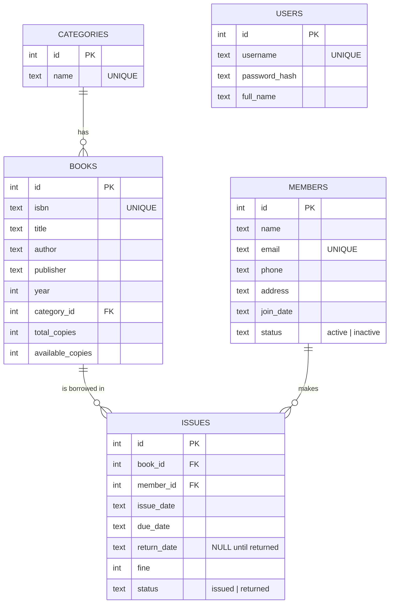

# ER Diagram

A picture version is in [`er_diagram.svg`](er_diagram.svg) (open it in any browser).

## Mermaid diagram

## Relationships

| Relationship | Cardinality | Meaning |
|---|---|---|
| categories - books | 1 : N | A category contains many books; a book belongs to at most one category. |
| books - issues | 1 : N | A book can be issued many times over its life. |
| members - issues | 1 : N | A member can borrow many books over time. |
| books - members (via issues) | M : N | `issues` is the junction (associative) table. |

`users` is independent - it stores librarian/admin credentials only.

## Normalisation

* **1NF** - every column holds one atomic value; every table has a primary key.
* **2NF** - all non-key attributes depend on the whole key (all PKs are single columns).
* **3NF** - no transitive dependencies: category names live in `categories`, not repeated in `books`;
  member and book details live in their own tables, not copied into `issues`.
